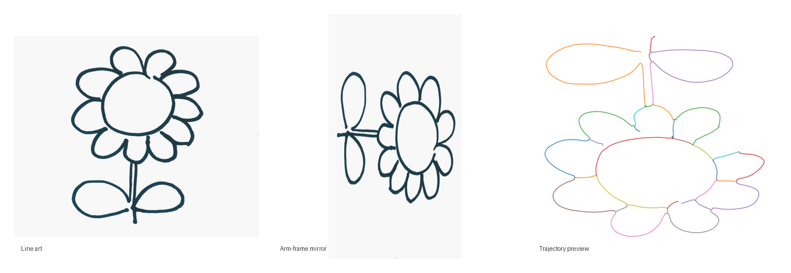
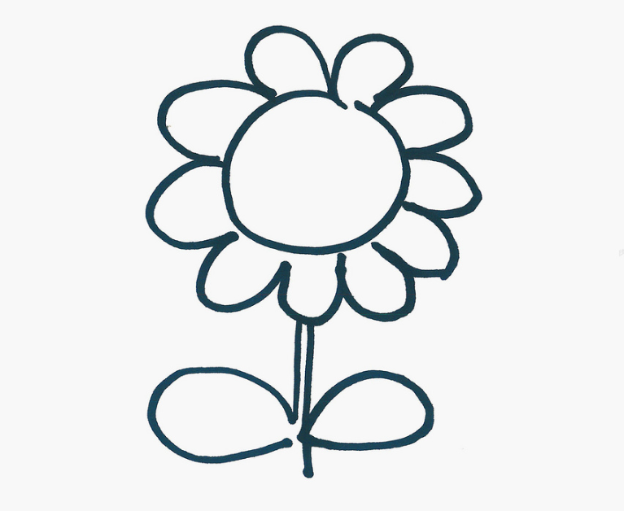
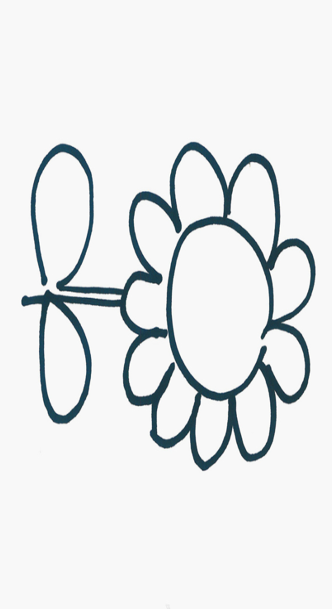
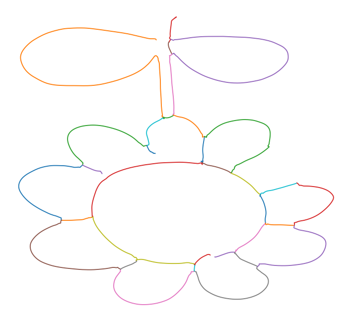
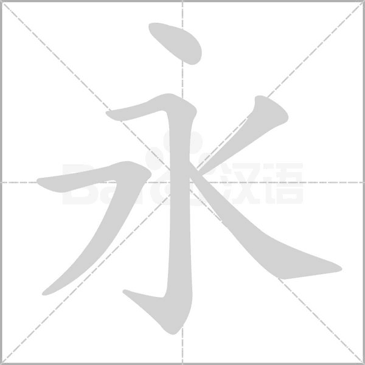
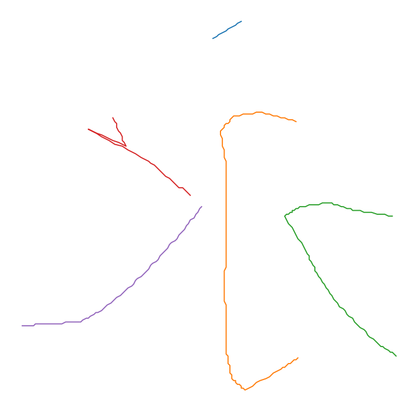
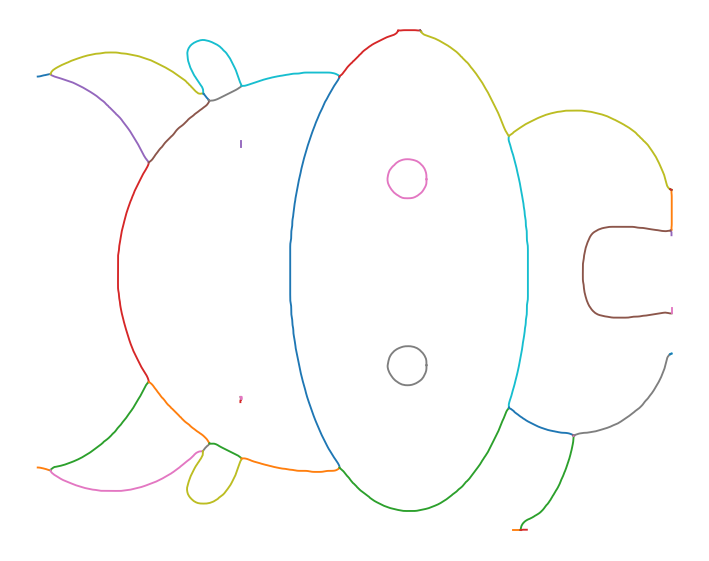
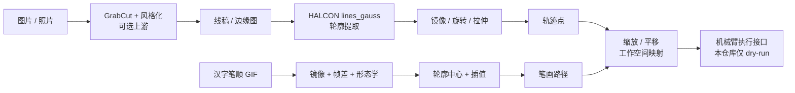

# RoboArmDev · 六自由度机械臂绘画 / 写字项目

> 把图片、线稿和汉字笔顺转换成机械臂可执行的轨迹坐标。  
> 团队项目展示 · 包含我的模块、必要上下游和明确的团队分工。



## 项目简介

这是一个团队技术项目（2024）。项目目标是把**图片 / 汉字**转换成 6-DOF 机械臂可以执行的绘画、写字轨迹，覆盖：

- 图片 → 线稿/风格化
- 线稿 → HALCON 轮廓 → 轨迹点
- 汉字笔顺 GIF → 笔画坐标 → 轨迹点
- 坐标归一化、镜像变换、工作空间映射
- 轨迹 → 机械臂执行接口

本仓库是**个人模块 + 必要上下游的整理版**，不是完整团队工程。机械臂 IK、硬件 SDK 和最终执行代码由队友完成，未包含在这里；我会在下面的“团队分工”里写清楚边界。

## 团队分工

| 模块 | 位置 | 作者 | 说明 |
|---|---|---|---|
| 图片风格化 / 线稿上游（可选） | `src/vision/style_transfer.py` | Dii（团队） | GrabCut + TensorFlow Hub；非我的个人成果，保留是为了讲清完整链路 |
| 线稿轮廓 → 轨迹坐标 | `src/halcon/line_to_path.py` | 安津毅 | HALCON `lines_gauss`、XLD 轮廓、坐标输出 |
| 汉字笔顺 GIF → 点 → 路径 | `src/chinese/` | 安津毅 | 镜像 GIF、帧差、形态学、轮廓中心、插值 |
| 鼠标轨迹采集 | `src/drawing/` | 安津毅 | OpenCV 鼠标绘制 → 轨迹文件 |
| 轨迹归一化 / 工作空间映射 | `src/trajectory/resize.py` | 安津毅 | 缩放到 20×20，平移到目标工作空间 |
| 轨迹 → 机械臂执行接口 | `src/robot/execute_path.py` | 安津毅（接口整理） | 基于团队执行脚本的接口抽象；真实 SDK 未包含 |
| 机械臂 IK / ArmPi / Hiwonder SDK | 未包含 | Chenxin / 团队 | 原项目执行层，因硬件和许可原因不放进本仓库 |
| 演示素材 | `examples/`、`docs/images/` | 团队 | 线稿、路径、笔画和演示图来自团队项目 |

**我的贡献**：线稿轮廓提取与轨迹生成、汉字笔顺坐标生成、坐标归一化与镜像变换、模块集成。  
**不冒领**：图片风格化来自 Dii；机械臂 IK/驱动/执行来自 Chenxin 及团队；本仓库只保留执行层的接口示例。

## 效果演示

| 线稿输入 | 机械臂坐标系镜像 | 轨迹预览 |
|---|---|---|
|  |  |  |

汉字“永”的笔顺 GIF 经过同一套流程生成 5 条笔画路径：

| 笔顺 GIF | 生成轨迹 |
|---|---|
|  |  |

“花”字的笔画动画（由 `examples/strokes/hua.txt` 渲染）：


团队执行层的轨迹示例（`examples/cow/arm_path.txt`，仅做 dry-run 预览）：



## 系统流程



## 模块说明

### 1. 线稿 → 轨迹（HALCON）

`src/halcon/line_to_path.py` 处理流程：

1. 按机械臂坐标系做 X 方向拉伸、转置和水平镜像；
2. 用 HALCON `lines_gauss` 提取线状轮廓（XLD）；
3. 把每条轮廓的 `(row, col)` 转成 `(x, y)` 轨迹；
4. 保存为 Python 列表格式，供后续归一化和执行层读取。

HALCON 是 MVTec 的商业软件。本仓库**不包含** HALCON 的 DLL、许可证或破解文件；运行前需自行安装 HALCON 23.05 Progress（或兼容版本）和 Python 接口。

### 2. 汉字笔顺 GIF → 轨迹

`src/chinese/` 的流程：

1. `reverse_gif.py`：水平镜像 GIF，匹配机械臂坐标系；
2. `gif_to_points.py`：逐帧做差分，中值滤波、开/闭运算、Otsu 二值化，取新增笔画轮廓中心；
3. 按距离阈值插值，`-1,-1` 分隔不同笔画；
4. `points_to_path.py`：转换为 `[[[x, y], ...], ...]` 路径列表。

原项目的 GIF 爬虫依赖百度页面的旧 Cookie 和 HTML 结构，**未包含**。仓库里的 `examples/strokes/yong.gif` 是团队项目中的示例素材；请只使用你有权使用的 GIF。

### 3. 坐标归一化

`src/trajectory/resize.py` 把轨迹的最长边缩放到 20 个单位，再平移到配置的工作空间锚点（默认 `x=10, y=30`）。`z` 高度由 `src/robot/execute_path.py` 按 `y` 做简单分段。

### 4. 机械臂执行接口

`src/robot/execute_path.py` 定义了最小接口：

```python
controller.set_pitch_range_moving((x, y, z), pitch, roll_min, roll_max, speed)
```

默认的 `DryRunController` 只打印轨迹，方便没有硬件的评审查看。真实项目里把 `ArmIK`/Hiwonder SDK 封装成这个接口即可；本仓库不包含硬件驱动。

## 快速开始

### 环境

```bash
python -m venv .venv
source .venv/Scripts/activate   # Git Bash on Windows
pip install -r requirements.txt
```

要求 Python 3.9+。`requirements.txt` 只包含预览和汉字流程所需的轻量依赖；HALCON 和 TensorFlow 是可选重依赖。

### 1. 无需 HALCON 的轨迹预览

```bash
python scripts/preview_path.py \
  --input examples/flower/path.txt \
  --out docs/images/flower-path-preview.png
```

### 2. 汉字笔顺 → 轨迹

```bash
python -m src.chinese.run_pipeline \
  --gif examples/strokes/yong.gif \
  --word yong \
  --out-dir examples/strokes
```

输出 `examples/strokes/yong_path.txt`，并打印笔画/点数统计。

### 3. 机械臂执行接口（dry-run）

```bash
python -m src.robot.execute_path \
  --path examples/cow/arm_path.txt \
  --limit 20
```

### 4. HALCON 线稿提取（可选）

安装 HALCON 并激活许可证后：

```bash
python -m src.halcon.line_to_path \
  --input examples/flower/lineart.png \
  --mirror examples/flower/mirror_halcon.png \
  --out examples/flower/path_halcon.txt
```

### 5. 图片风格化（可选，需 TensorFlow）

```bash
pip install -r requirements-ml.txt
python -m src.vision.style_transfer \
  --content examples/cow/lineart.jpg \
  --style examples/flower/lineart.png \
  --out examples/cow/stylized.jpg
```

TensorFlow Hub 模型地址可能随上游更新；如果失效，请按 `src/vision/style_transfer.py` 里的注释替换模型。

### 6. 鼠标画图（可选，需要图形界面）

```bash
python -m src.drawing.repeat_drawing --out-dir examples/drawing
```

## 项目结构

```text
.
├─ src/
│  ├─ halcon/line_to_path.py      # 线稿 → HALCON 轮廓 → 轨迹
│  ├─ chinese/                    # 汉字 GIF → 笔画 → 路径
│  ├─ drawing/                    # 鼠标轨迹采集
│  ├─ trajectory/resize.py        # 归一化 / 工作空间映射
│  ├─ vision/style_transfer.py    # 可选上游（作者 Dii）
│  └─ robot/execute_path.py       # 执行接口 + dry-run
├─ examples/
│  ├─ flower/                     # 线稿、镜像、路径
│  ├─ strokes/                    # 笔顺 GIF、路径、笔画动画数据
│  └─ cow/                        # 团队执行层轨迹与线稿
├─ scripts/
│  ├─ preview_path.py             # 路径 → PNG
│  └─ render_strokes_gif.py       # 笔画路径 → GIF
├─ docs/
│  ├─ HALCON.md
│  ├─ TEAM.md
│  └─ images/
├─ requirements.txt
└─ requirements-ml.txt
```

## 技术点

- **HALCON `lines_gauss`**：对线稿做亚像素级线状轮廓提取，比普通 Canny 更适合连续笔画。
- **帧差 + 形态学 + Otsu**：从笔顺 GIF 中提取每帧新增区域，降低颜色和压缩噪声影响。
- **轮廓中心 + 插值**：把离散的笔画中心变成适合机械臂连续运动的密集点列。
- **坐标变换**：镜像、转置、拉伸、缩放、平移，把图像坐标映射到 6-DOF 机械臂工作空间。
- **接口隔离**：`ArmController` 协议把轨迹生成和硬件 SDK 解耦；没有硬件也能 dry-run。
- **可复现的轻量演示**：不安装 HALCON/TensorFlow，也能用 `scripts/preview_path.py` 和 `src.chinese.run_pipeline` 查看轨迹。

## 限制与说明

- 本仓库**不是完整团队工程**：机械臂 IK、硬件 SDK、末端执行器控制和真实标定不在其中，因此不能一键复现真实写字/绘画。
- HALCON 是商业软件，仓库不附带 DLL/许可证；没有许可证无法运行线稿轮廓提取。
- `src/vision/style_transfer.py` 是队友 Dii 的模块，依赖 TensorFlow/TF-Hub，模型地址可能变化；不作为本仓库的主要可运行路径。
- `examples/cow/arm_path.txt` 是团队执行层数据，用来展示“同一条链路的后半段”，不是我的独立产出。
- 不写未测量的性能/效率数字；项目价值在于**把视觉输出变成可执行的轨迹**，而不是某个基准分数。

## 素材与使用说明

- 素材来自团队项目：`examples/flower/*`、`examples/strokes/yong.gif`、`examples/cow/*`；上游笔顺素材来自团队的 shufa-main 资料。
- 已移除：HALCON 二进制/许可证、硬编码 Cookie、公司 Logo/内部照片、无关 ZIP 和缓存。
- 本项目为团队作品展示，**未添加开源 LICENSE**；未经许可请勿商用。引用/复用请先联系作者确认团队授权。

## 致谢

感谢团队成员的图像风格化、机械臂执行与系统集成工作；本仓库只展示我在“图片/汉字 → 轨迹”部分的工作，并把必要的上下游接口整理成可读的形式。
